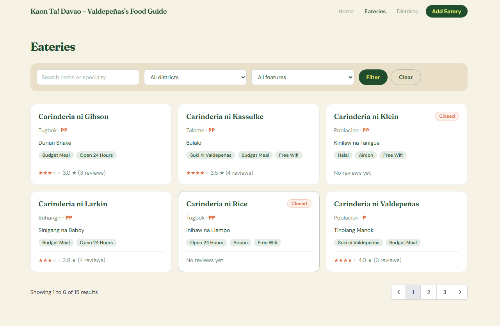
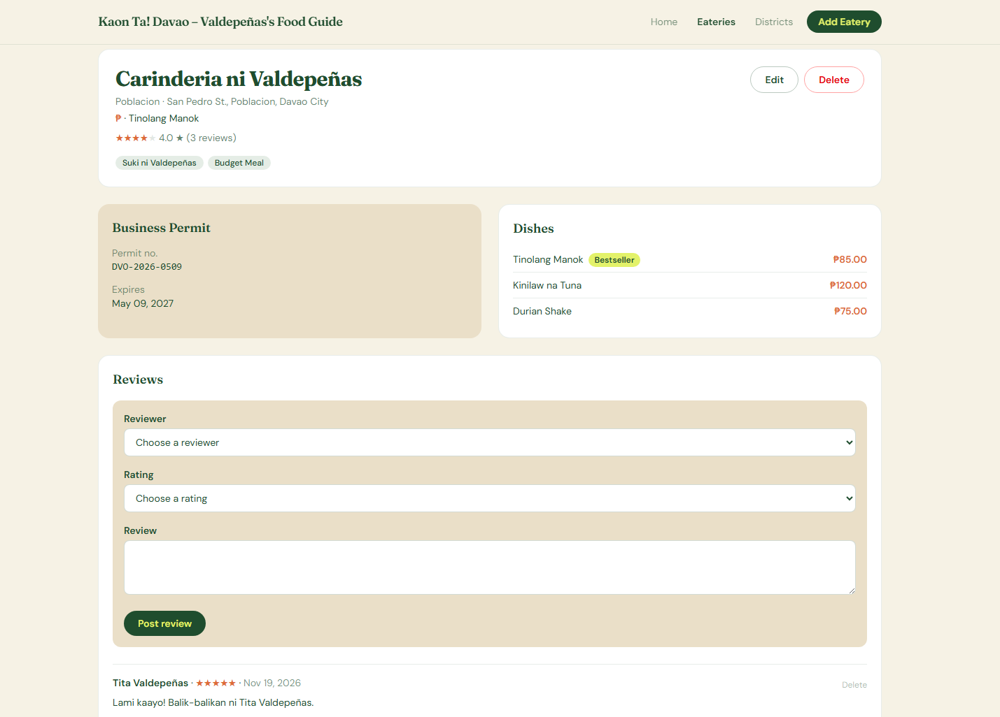
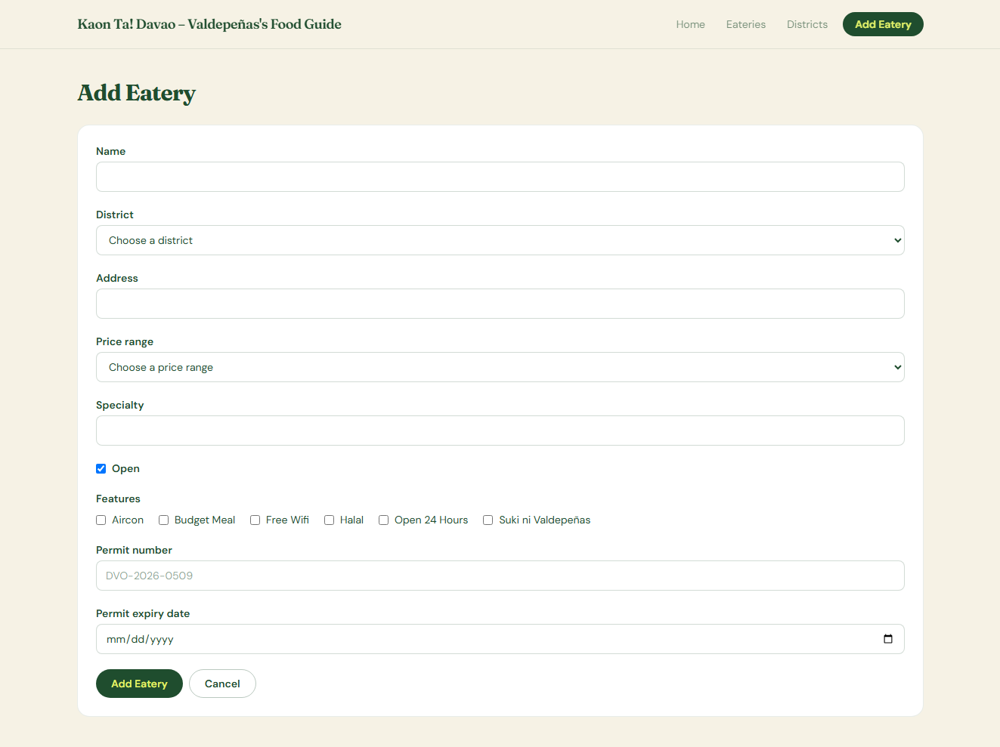

# Kaon Ta! Davao: Carinderia & Eatery Guide
Sarah Valdepeñas

## Setup
```
composer install
cp .env.example .env
php artisan key:generate
touch database/database.sqlite
php artisan migrate:fresh --seed
npm install
npm run build
php artisan serve
```

## My data
- Districts: Poblacion, Talomo, Agdao, Buhangin, Toril, Tugbok
- Features: Suki ni Valdepeñas, Budget Meal, Halal, Open 24 Hours, Aircon, Free Wifi
- Users: Sarah Valdepeñas (valdepenas@kaonta.test), Tita Valdepeñas (tita.valdepenas@kaonta.test), password kaonta2026
- My eatery: Carinderia ni Valdepeñas, Poblacion, permit DVO-2026-0509

## Relationships
| Relationship | Type | Why |
|---|---|---|
| District → Eatery | hasMany / belongsTo | one district has many eateries |
| Eatery → Dish | hasMany / belongsTo | one eatery has many dishes |
| Eatery → Review | hasMany / belongsTo | one eatery has many reviews |
| User → Review | hasMany / belongsTo | one user writes many reviews |
| Eatery → Permit | hasOne / belongsTo | one eatery has only one permit |
| Eatery ↔ Feature | belongsToMany | many eateries share many features, so it needs a pivot table |
| District → Review | hasManyThrough | reviews belong to eateries, so we reach them through the district's eateries |

## Routes
```
GET|HEAD  /                          home > HomeController
GET|HEAD  districts                  districts.index > DistrictController@index
GET|HEAD  districts/{district}       districts.show > DistrictController@show
GET|HEAD  eateries                   eateries.index > EateryController@index
POST      eateries                   eateries.store > EateryController@store
GET|HEAD  eateries/create            eateries.create > EateryController@create
GET|HEAD  eateries/{eatery}          eateries.show > EateryController@show
PUT|PATCH eateries/{eatery}          eateries.update > EateryController@update
DELETE    eateries/{eatery}          eateries.destroy > EateryController@destroy
GET|HEAD  eateries/{eatery}/edit     eateries.edit > EateryController@edit
POST      eateries/{eatery}/reviews  eateries.reviews.store > ReviewController@store
GET|HEAD  reviewers/{user}           reviewers.show > ReviewerController@show
DELETE    reviews/{review}           reviews.destroy > ReviewController@destroy
```

## Screenshots


